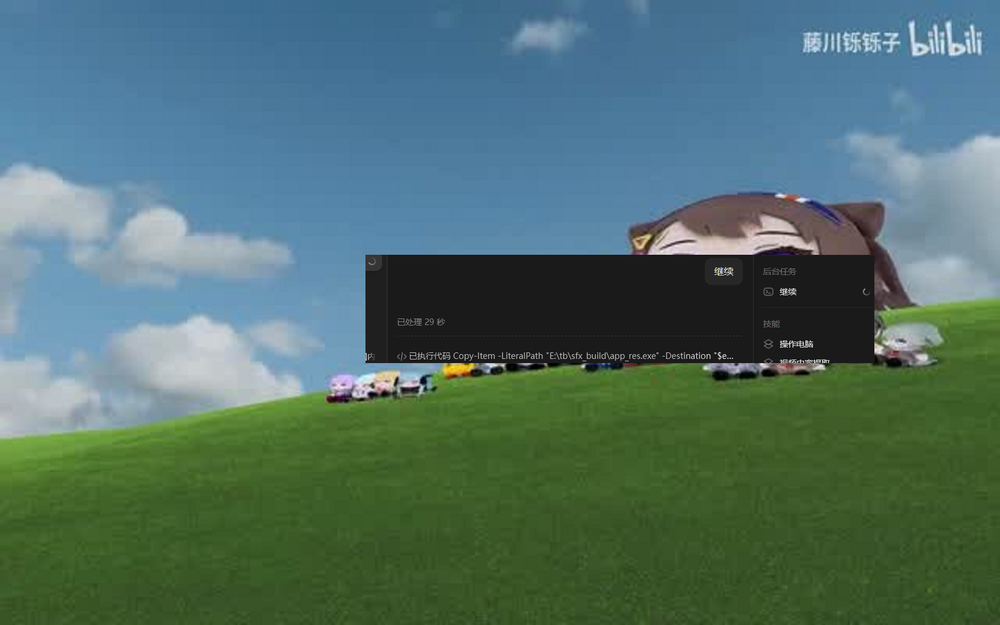

# 桌面弹弹弹 · 朋友的酒

一个开源的 Windows 桌面整蛊程序：双击一个 exe，桌面图标和窗口跟着 130 BPM 的音乐一起 Q 弹，整屏撕裂 / 反色 / 融化，弹原生对话框、变色 CMD、视频小窗，最后用一段收尾动画结束。**纯本地运行，不联网、不改系统文件、不碰你的数据。**



> 这是玩笑程序，里面带了自解压的东西，第一次运行可能被部分安全软件误报。
> 本应用无害，只会动桌面图标、弹窗和画面；二创请艾特原创；由豆包赞助开发。

---

## 功能一览

| 模块 | 行为 |
|---|---|
| 图标 Q 弹 | 接管桌面图标层，原图标隐藏，屏上只有会弹的图标；整数像素落位、标签按资源管理器规则断行 |
| 窗口 Q 弹 | 所有可见窗口同一套公式；运行中新开的窗口半秒内加入；最大化窗口被压回屏幕 70% |
| 桌面帧画面 | mp4 按 **25fps / 640×360** 拆成 4683 张 jpg，按音乐位置取帧，由**独立 25fps 线程**画进一层穿透分层窗口（壁纸之上、图标与窗口之下），卡顿只掉帧不停播 |
| 原生对话框 | 每个拍点 30% 概率弹「朋友的酒」对话框（警告 / 报错 / 问号 / 纯文字），上限 5 个 |
| 自动打开应用 | 每拍 35% 概率从 19 项白名单拉系统小工具，**上限 4 个**，开第 5 个时先关最早那个 |
| 变色 CMD | `cmd.exe` 里 `color` 24 组配色循环，约 1 秒一换，最多 3 个；关掉任意一个 → 结束一个自动打开的程序 |
| 视频小窗 | 两个 320×180 置顶小窗播 mp4，每两拍平滑换落点，始终夹在屏幕内 |
| 跟随鼠标窗 | 标题「《朋友的酒》已入侵你的电脑」，内容也是那段视频，跟着鼠标走 |
| 整屏 GDI 特效 | 每拍抖 ±4px + 反色 + 残影 + 切条；常驻撕裂从第 1.2 秒开始 |
| NetGDI 七特效 | 反色 / 模糊 / 圆形隧道 / 阴影画刷 / 图案画刷 / 颜色滤镜 / 屏幕融化（独立宿主进程 `NgdiRun.exe`） |
| 每拍一声 | 55% 概率从 do~高do 八个音里随机挑一个，90–180 ms，后台线程播放 |
| 一直打字 | 每 0.1 秒一个字符，`78917891` 循环 |
| 收尾 | 音乐放完 → 关掉所有弹窗与外部程序 → `ending.wav` → 收尾卡片 + 满屏飘字 → 定格 30 秒（随时可退出）→ 退出 |

**节奏怎么保证严格跟音乐**：130 BPM、406 拍、拍长 0.4615 秒，音频 187.371 秒。不用计时器推节奏，每帧读「音频已播到第几个采样」算相位，机器卡一下下一刻立刻回到该在的位置。

---

## 运行要求

| 项 | 要求 |
|---|---|
| 系统 | Windows 7 **SP1** / 8.1 / 10 / 11，**64 位** |
| 运行时 | .NET Framework 4.8（Win10/11 自带；Win7/8.1 首次运行会**自动静默安装**） |
| 磁盘 | `%TEMP%` 所在盘留约 390 MB（单文件版首次启动要解压）；缓存目录约 120 MB |
| 退出 | `Ctrl + Alt + Q` 或 `Ctrl + Shift + Q`（全局热键 + 每帧轮询双保险） |

- **Win7 SP0（版本 7600）会被直接拦掉**，提示先升级到 SP1，不进入任何安装流程——SP0 装不上 SHA-2 补丁，也装不上 .NET 4.8。
- Win7 缺 SHA-2 签名支持时，包里垫了官方补丁 `windows6.1-kb4474419-v3-x64.msu`；如果补丁要重启，会自动写一条 **RunOnce**（一次性自启动），重启后接着装完并拉起主程序，用户不用再点。

## 快速开始

1. 到 **Releases** 下载 `DesktopJelly-Full.exe`（约 309 MB，单文件，只拷这一个就行；本地文件名就是 桌面弹弹弹.exe）。
2. 双击运行 → 弹说明页 → 点「运行」。
3. 想结束：`Ctrl + Alt + Q`。任务管理器强杀也不会把桌面留在撕烂状态（守护进程会把图标放回来）。

想更轻量可以用 `DesktopJelly-Lite.exe`（即 备份-126MB自解压版.exe）（不含 Python 外壳与 .NET 垫包，目标机必须已装 .NET 4.8）。

---

## 目录结构

```
.
├─ src/                 # 全部 C# 源码 + 打包脚本
│  ├─ JellyAll.cs        # 主循环 / 节拍 / 各模块编排
│  ├─ FrameStage.cs      # 25fps 帧画面（分层窗口 + 独立线程）
│  ├─ JellyLayer.cs      # 图标 Q 弹的分层渲染
│  ├─ ScreenFx.cs        # 抖动 / 反色 / 残影 / 切条
│  ├─ NetGdiFx.cs        # 七种 NetGDI 特效的接线
│  ├─ PopWindows.cs      # 自动打开应用（满 4 个关最早）
│  ├─ CmdColor.cs        # 变色 CMD 窗口
│  ├─ VideoWindows.cs    # 两个视频小窗
│  ├─ CursorFollow.cs    # 跟随鼠标的置顶窗
│  ├─ VictimWindows.cs   # 收尾卡片 + 满屏飘字
│  ├─ Sfx.cs             # 自解压壳（9 份内嵌资源）
│  ├─ launcher.py        # Python 外壳：.NET 安装 / payload 解包 / 桌面复原
│  ├─ build.cmd          # 编译主程序 + NetGDI 宿主
│  └─ build_sfx.cmd      # 打自解压包
├─ docs/
│  ├─ usage-and-optimization.md
│  └─ images/            # 效果截图
├─ tools/
│  ├─ extract_frames.py  # mp4 → 视频帧/（fps=25, 640×360）
│  └─ build_frames_dat.py# 视频帧/ → frames.dat
├─ LICENSE
└─ README.md
```

## 从源代码构建

需要 Windows + .NET Framework 的 `csc.exe`（系统自带）与 Python 3。

```bat
:: 1) 主程序 + NetGDI 宿主（产物在 %TEMP%\sfx_build\）
cd src
build.cmd

:: 2) 自解压单文件包
build_sfx.cmd
```

打 Python 外壳版（推荐，单文件、能自动装 .NET）：

```bat
python -m PyInstaller --noconfirm --clean --onefile --windowed ^
  --icon app.ico --name DesktopJellyBoot ^
  --add-data "<payload目录>;payload" launcher.py
```

`payload/` 里放 11 个文件：

```
app.exe  audio.wav  video.mp4  victim.jpg  ending.wav  tgpv.exe
NetGDI.dll  NgdiRun.exe  frames.dat  ndp48.exe  windows6.1-kb4474419-v3-x64.msu
```

## 重新生成帧序列

```bash
python tools/extract_frames.py            # 需要 ffmpeg（或 pip install imageio-ffmpeg）
python tools/build_frames_dat.py          # 生成 frames.dat
```

`frames.dat` 是自定义容器：`FRMD` + int32 帧数 + 每帧「int32 长度 + JPEG 字节」。程序优先读 `视频帧/` 文件夹，没有才读 `frames.dat`。

## 常见问题

| 现象 | 处理 |
|---|---|
| 安全软件误报 | 自解压结构 + 画面改动容易触发；加白名单即可，程序不联网 |
| 弹「因内存不足而无法启动」 | 看 `%TEMP%` 所在盘空间，不是内存 |
| 图标发白 / 空白 | Explorer 图标缓存；执行 `ie4uinit.exe -show` 或重开资源管理器 |
| 屏幕没有视频画面 | 缓存目录要有 `frames.dat`（62 MB）；日志里应有「桌面帧画面：已加载 4683 帧」 |
| .NET 装不上 | 看 `%LOCALAPPDATA%\朋友的酒\dotnet_install.log`；Win7 先确认 SP1 + KB4474419；安装窗口里有「手动安装（显示进度）」 |
| 退出后还有残影 | 等 1–2 秒；仍不对就再跑一次并正常退出（会重绘桌面并重套壁纸） |
| 快捷键没反应 | 试 `Ctrl+Shift+Q`；不行就任务管理器结束，守护进程会把图标放回来 |

## 免责声明

- 仅供娱乐与学习 Windows GDI / DWM / 音频同步，**不要**用于骚扰他人。
- 会修改窗口尺寸、隐藏桌面图标、播放声音，请在自己或知情同意的机器上运行。
- 二创请艾特原创；由豆包赞助开发。

## 开源

该程序已开源，希望你能支持一下：`https://github.com/1daodun1/bounce-window-prank`（发布前替换成你的 GitHub 链接）

## License

[MIT](LICENSE)
